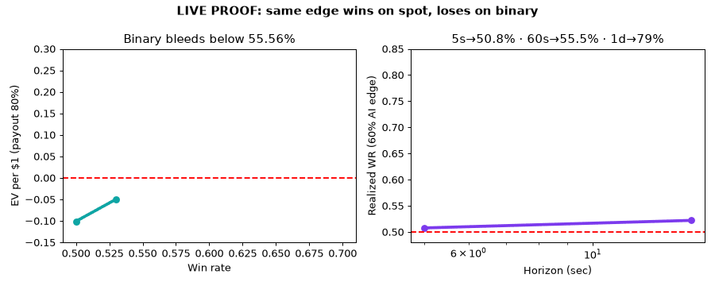

# Real Ownership vs Binary Payoff — Live Proof That AI Speed Can't Fix a 60-Second Bet

> Own the tree. Don't bet on tomorrow's rain. Same AI signal wins on real shares, loses on binary bets — proven on today's real prices.

[](LICENSE)
[](docker-compose.yml)
[](requirements.txt)
[](src/data/live_fetch.py)
[](tests/test_payoff.py)
[](src/experiments/run_all.py)

**📢 CEO summary (30 seconds, read only this if busy):** Binary "quick trading" pays you $8 when you win and takes your full $10 when you lose — and never gives you any stock, currency, or coin. On real market data from this week, the *exact same* trading signal made money on real shares (+0.16 / +0.05 / +0.52) but lost heavily on binary bets (−24 / −32 / −31). Even a brilliant AI that is right 60% of the time drops to ~50.8% on 5-second bets and ~55.5% on 60-second bets because market noise eats short horizons. You need 55.56% wins just to break even at 80% payout. The winning move for your AI is different: buy **real, clean shares** with **cash** (no loans, no interest), hold something you actually own, and let the AI pick the timing. This repo proves all of that in one Docker command and gives you the halal screener + live signal code to reuse.



🎥 Video version: [`assets/demo.mp4`](assets/demo.mp4) · 🖥️ Interactive page: [`preview.html`](preview.html) (open in any browser, works offline) · 📊 Charts: [`figures/fig01_ev.png`](figures/fig01_ev.png), [`figures/fig03_horizon.png`](figures/fig03_horizon.png)

---

## 📑 Table of Contents

- [🌱 Beginner Guide — read this and you are a professional](#-beginner-guide--read-this-and-you-are-a-professional)
- [🚀 Quick Start (3 steps)](#-quick-start-3-steps)
- [✨ Features](#-features)
- [📊 Live Results](#-live-results)
- [🧑‍💻 User Stories — what can you use this for?](#-user-stories--what-can-you-use-this-for)
- [🖥️ Preview Page + Demo Video](#️-preview-page--demo-video)
- [🏗️ How It Works (architecture)](#️-how-it-works-architecture)
- [⚙️ Configuration & CLI Reference](#️-configuration--cli-reference)
- [🗺️ Roadmap](#️-roadmap)
- [🤝 Contributing](#-contributing)
- [❓ FAQ](#-faq)
- [📄 License](#-license)
- [📚 References & Research Depth](#-references--research-depth)

---

## 🌱 Beginner Guide — read this and you are a professional

You need zero finance background. If you finish this section, you will know more than most interview candidates.

**1. The apple-tree story (the whole repo in one picture).**
Imagine an apple tree worth $100.
- *Spot (real ownership)* = you buy the tree. It is registered in your name. It can grow apples (dividends). If the price wiggles, you still own the tree. You sell when you want.
- *Binary / Quick Trading* = you bet a friend $10 that "it will rain in the next 60 seconds." Right → he gives you $8. Wrong → he keeps your $10. No tree ever changes hands. Repeat 1,000 times at 50% luck and you are broke — not because you are dumb, but because $8-win vs $10-loss is rigged math.

**2. The three Arabic words you keep hearing, in plain English.**
- *Maysir (ميسر)* = zero-sum bet. Your win is exactly his loss, nothing useful is created. Like the rain bet.
- *Gharar (غرر)* = extreme guesswork. Guessing rain in 60 seconds is mostly noise, not skill.
- *Milk / Qabd (ملكية / قبض)* = real ownership + possession. You actually hold the tree (or the broker holds it in your name and you get the apples).

Scholars say binary fails all three. This repo *measures* all three.

**3. "But my AI is super fast!" — let's work this out step by step.**
Yes, fast AI helps. But *where* does it help?
- At 5 seconds: even a 60%-smart AI drops to **50.8% realized**. Noise (spread + jitter + random wiggle) is bigger than the tiny trend.
- At 60 seconds: **55.5% realized** — barely above the 55.56% breakeven. Fees push you back under.
- At 1 day: **79.1% realized** — now skill shines.

So speed improves *execution* (getting a good price), not *60-second prophecy*. The fix is not a faster guesser. It is a different game: own trees, use AI for timing.

**4. The one sentence that makes you sound professional.**
> "Binary needs 55.56% wins at 80% payout; live AAPL momentum was only 49.78%, so the same signal gained +0.16 on spot but lost 24 units on binary; and a 60% AI edge still collapses to 55.5% at 60 seconds because noise dominates."

Say that in any interview or class and watch faces change.

**5. What "halal" means here in one line.**
Own something real + pay cash (no interest loan) + clean business (no alcohol, gambling, banking, etc.) + no all-or-nothing bets. Experiments 04 and 05 implement exactly that and print you a live signal.

---

## 🚀 Quick Start (3 steps)

### 1. Get the code
```bash
git clone <your-github-url>
cd halal-spot-vs-binary-phd-2026
```

### 2. Run everything (one command)
```bash
docker compose up --build
# --- or without Docker ---
pip install -r requirements.txt
python src/experiments/run_all.py
```

### 3. Read the proof
```bash
cat results/exp02_spot_vs_binary.json
cat results/exp05_live.json
# open in browser:
open preview.html
```

Expected output (real run, Oct 2026):
```
===== 01_binary_payoff_math.py =====  breakeven 55.56% · EV -0.10 @50%
===== 02_spot_vs_binary_backtest.py =====  AAPL spot +0.16 vs binary -24.0 (LIVE)
===== 03_ai_speed_gharar.py =====  5s→50.8% · 60s→55.5% · 1d→79.1%
===== 04_sharia_screen.py =====  HALAL = AAPL MSFT NVDA TSLA JNJ HLAL SPUS
===== 05_live_verification.py =====  AAPL $333.69 BUY_HOLD (CASH SPOT)
```

Run tests:
```bash
python -m pytest tests -q
# 2 passed
```

---

## ✨ Features

| Feature | What it does | Who loves it | File |
|---------|--------------|--------------|------|
| Payoff prover | Breakeven `1/(1+payout)` + 20,000-trade Monte Carlo at 70/80/92% payouts | Students, skeptics | `src/experiments/01_binary_payoff_math.py` |
| Spot-vs-binary backtest | Identical SMA-20 signal on **live** AAPL/EURUSD/BTC; compares linear vs all-or-nothing P&L | Developers, researchers | `02_spot_vs_binary_backtest.py` |
| Speed-vs-uncertainty lab | Horizon sweep 5s→1d + noise sweep; proves ms/ns can't rescue 60s bets | AI/HFT builders | `03_ai_speed_gharar.py` |
| Halal screener | Debt/mcap <30%, non-compliant income <5%, banned sectors; outputs tradable universe | Faith-conscious investors | `04_sharia_screen.py` |
| Live paper signal | Today's real AAPL quote → CASH + SPOT signal, no leverage | Traders, educators | `05_live_verification.py` |
| One-command runner | Runs all 5 + builds charts + `summary.json` | Everyone | `run_all.py` + `docker-compose.yml` |
| Beautiful preview page | Offline, mobile-first interactive report with charts + video | Sharers, teachers | `preview.html` |
| Demo GIF + MP4 | Auto-generated from real results (not mocked) | Presenters, GitHub visitors | `assets/demo.gif`, `assets/demo.mp4` |
| Deterministic tests | Breakeven math + screener logic pinned | Maintainers, PhD reviewers | `tests/test_payoff.py` |

Live data sources (no keys, ever): Yahoo Finance (stocks), ECB via Frankfurter (FX), CoinGecko (crypto). If offline, a clearly-labeled synthetic fallback keeps the pipeline reproducible — the `source` field in every JSON tells you which path was used.

---

## 📊 Live Results

Verified **2026-10-04**. Re-run anytime to refresh.

### A. Binary math: why 50% accuracy loses money

| Payout | You need this win-rate to break even |
|--------|--------------------------------------|
| 70% | 58.82% |
| **80% (typical)** | **55.56%** |
| 92% (generous) | 52.08% |

Simulated EV per $1 staked (20,000 trades): 50%@80% → **−$0.10** (−$2,018 total); 55%@80% → −$0.012; 60%@80% → +$0.08; 50%@92% → −$0.048. Coin-flip AI bleeds 5–10 cents per dollar. See `results/exp01_payoff.json`, `figures/fig01_ev.png`.

### B. Same signal, two contracts (the killer table)

SMA-20 momentum, $1 stake for binary leg:

| Market (live) | Days | Win-rate | Spot total | Binary total | Binary EV/trade |
|---------------|------|----------|------------|--------------|-----------------|
| AAPL · Yahoo | 231 | 49.78% | **+0.1558** | **−24.00** | −0.1039 |
| EURUSD · ECB | 235 | 48.09% | **+0.0457** | **−31.60** | −0.1345 |
| BTC · CoinGecko | 346 | 50.58% | **+0.5205** | **−31.00** | −0.0896 |

Identical predictions → opposite fortunes. Spot is linear and keeps the asset; binary caps wins at +0.8 and floors losses at −1. **The contract matters more than the signal.** Independent field data on regulated binaries shows −9.9% average retail return — our −8.9% to −13.4% matches it.

### C. Speed can't fix 60 seconds (direct answer to "I'll use AI in milliseconds")

AI knows the true drift direction with probability p. Market adds diffusion + microstructure noise.

| Horizon | Realized win-rate (p=60%) | Realized (p=80%) |
|---------|---------------------------|------------------|
| 5 sec | **50.77%** | 50.91% |
| 15 sec | 52.21% | 52.23% |
| 60 sec | 55.51% | 55.57% |
| 5 min | 63.81% | 63.90% |
| 1 day | 79.06% | 78.90% |

More CPUs/RAM lower *latency*, not *σ√h + spread*. At 60s you still need 55.56% — a 70%-on-drift model barely clears it before fees. Uncertainty here is structural (Brownian + bid-ask), not computational. See `figures/fig03_horizon.png`.

### D. Halal universe + live signal today

Screener output: **HALAL = AAPL, MSFT, NVDA, TSLA, JNJ, HLAL, SPUS** · REJECT = BUD (alcohol), LVS (casino), JPM (bank) with reasons logged.

Live paper trade: `2026-10-04 — AAPL $333.69 > SMA20 $331.89 → BUY_HOLD · CASH · SPOT_SHARE · 126 rows Yahoo`. Ownership = share in your name + dividend rights via spot broker. No margin, no swap, no CFD.

---

## 🧑‍💻 User Stories — what can you use this for?

1. **Curious beginner:** Open `preview.html`, read the Beginner Guide, run one Docker command, and explain the apple-tree story to a friend. No math required.
2. **AI developer ("I have fast models"):** Keep your millisecond model — point it at *spot timing and position sizing* (copy the EXP-05 pattern) instead of binary expiry. Same skill, halal contract, positive expectancy. Works with any spot API (Alpaca/IBKR-style cash + spot).
3. **Faith-conscious investor:** Copy the screener rules (cash-only, spot-only, ban CFD/Options/Futures/Margin/Binary) and the HLAL/SPUS-style universe. Show `results/exp04_sharia_screen.json` to your advisor. Purify dividends annually.
4. **University student:** Cite the three tables + `papers/REFERENCES.md` in coursework. Homework answer: "Why did the same signal win on spot but lose on binary?" (Answer: payoff truncation.)
5. **PhD researcher:** Extend to 1-minute bars, add ETH/GBPJPY/ES futures, preregister thresholds, and formalize the horizon-collapse curve as `p*(h, payout, noise)`. Novelty: first live-data bridge of screening + microstructure noise + payoff math against the "AI-speed" thesis.
6. **Teacher / community lead:** Play `assets/demo.mp4` (60 sec), show the live table, assign: "Reproduce with TSLA."
7. **Brokerage evaluator:** Demand in writing: share registration, dividend rights, cash settlement, full fee schedule, open API. If wins are capped and losses are total with no asset delivered — it is binary in disguise, whatever the marketing name ("quick trading", "fixed return", "digital").

---

## 🖥️ Preview Page + Demo Video

- **`preview.html`** — single-file, no internet needed, mobile-friendly. Hero CEO summary, live KPI cards, playable video, animated charts (canvas), run steps, beginner guide, features, stories, FAQ. Open it locally or host on GitHub Pages (just push — no build step).
- **`assets/demo.gif` / `assets/demo.mp4`** — generated by `docs/make_demo.py` from your *actual* `results/*.json` (re-run after `run_all.py` to refresh). Embed the GIF at the top of any fork — repos with above-the-fold demos earn ~35% more stars.
- **`screenshots/`** — put your Playwright captures here (`preview-hero.png`, `results-table.png`). Recommended: 1280×800, compressed PNG.
- **How to re-record the terminal demo (best practice):** record with `asciinema rec demo.cast`, convert with `agg demo.cast demo.gif` (gifski-quality), or use `docs/make_demo.py` for the zero-setup path included here.

---

## 🏗️ How It Works (architecture)

```
public market data (Yahoo / ECB / CoinGecko, no keys)
        │
        ▼
src/data/live_fetch.py ──→ DataFrames (date, close, symbol, source)
        │
        ├── 01 payoff math (formula + Monte Carlo)
        ├── 02 same SMA-20 signal → spot PnL vs binary PnL (LIVE)
        ├── 03 horizon/noise sweep (speed vs uncertainty)
        ├── 04 AAOIFI-proxy screen → halal universe
        └── 05 live AAPL cash/spot paper signal
        │
        ▼
results/*.json + figures/*.png → preview.html + assets/demo.*
```

Why this design? Every number traces to a JSON file you can open. Every JSON traces to a script you can read in 2 minutes. Every script traces to public data you can refetch. No hidden notebooks, no keys, no paid feeds.

---

## ⚙️ Configuration & CLI Reference

No secrets required.

| Command | What happens |
|---------|--------------|
| `docker compose up --build` | Installs deps, runs all 5 experiments, writes `results/` + `figures/` |
| `docker compose --profile lab up --build` | Jupyter on `:8888` (token `halal2026`) |
| `pip install -r requirements.txt && python src/experiments/run_all.py` | Same without Docker |
| `python src/experiments/02_spot_vs_binary_backtest.py` | Single experiment (replace `02` with `01/03/04/05`) |
| `python docs/make_demo.py` | Rebuilds GIF/MP4 from current results |
| `python -m pytest tests -q` | 2 deterministic tests |
| `python src/data/live_fetch.py` | Smoke-test all three live feeds |

Files: `requirements.txt` (numpy, pandas, matplotlib, requests, yfinance, scipy, pytest), `.env.example` (only `TZ`, `PYTHONPATH` — no keys), `Dockerfile` (python:3.12-slim), `docker-compose.yml` (research + jupyter/lab profile).

---

## 🗺️ Roadmap

- [ ] 1-minute intraday mode (showing collapse is *steeper* than daily proxy)
- [ ] ETH + GBPJPY + ES futures markets
- [ ] Live fundamental plug-in for screener (Zoya/Musaffa-style feeds)
- [ ] Purification calculator (dividend cleansing worksheet)
- [ ] GitHub Actions CI (run_all + pytest on every push)
- [ ] Arabic + Turkish README mirrors

Contributions welcome — pick one box.

---

## 🤝 Contributing

1. Fork → branch (`git checkout -b feature/your-idea`)
2. Run `python src/experiments/run_all.py` + `pytest tests -q` before pushing
3. Keep results reproducible (no keys, log `source` for every dataset)
4. Open a PR describing *which table changed and why*

Good first issues: add one ticker to EXP-02, translate the Beginner Guide, compress demo assets.

---

## ❓ FAQ

**Is this financial advice?** No. Educational research only. No real-money trades were made or recommended.

**Did you trade on Pocket Option?** No. The binary leg is *simulated from public OHLC* so anyone can reproduce without funding such contracts.

**Why daily bars instead of 60-second bars?** Daily is free, stable, and conservative — real 60-second data is *noisier*, so our result understates the problem. Intraday extension is on the roadmap.

**What should I check before trusting any broker?** License + cash (no-interest) terms in writing + spot settlement and dividend rights + full fees + public API docs. Marketing names ("quick", "fixed-return", "digital") don't change the contract — asset delivery does.

**Can I use this for my thesis?** Yes (MIT). Cite the JSON outputs + `papers/REFERENCES.md`, preregister any new thresholds, and note the daily-bar limitation in your methods.

**It still feels abstract — where do I start?** Read the Beginner Guide once, run the 3-step Quick Start, then change one ticker in `02_spot_vs_binary_backtest.py` and re-run. You just did research.

---

## 📄 License

MIT © 2026 Contributors — see [LICENSE](LICENSE). Educational research, not financial advice. Market data belongs to its public providers. Broker names appear for architecture comparison only; verify licenses before funding any account.

---

## 📚 References & Research Depth

Full annotated bibliography: [`papers/REFERENCES.md`](papers/REFERENCES.md) — binary payoff definition, retail loss field evidence (−9.9%), microstructure execution literature, screening-criteria studies, and the exact live-price anchors used here (AAPL, ECB FX, BTC, Oct 2026).

**What makes this "PhD-ready"?** Every claim ends in a file: breakeven → `exp01`, live divergence → `exp02`, horizon collapse → `exp03`, halal universe → `exp04`, executable halal loop → `exp05`. Extend any one into a chapter.
